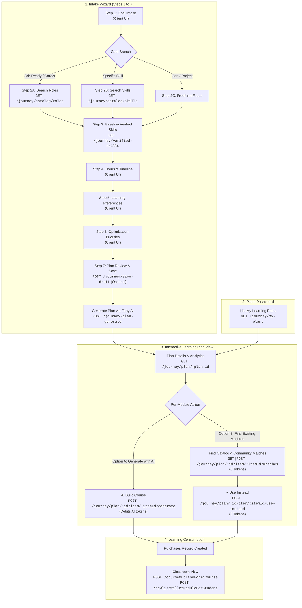

# Student Learning Path: Frontend Functionality Flow Guide

This document is the **step-by-step frontend integration reference** for the Student Learning Path feature on **mySkillWallet**. It details every API endpoint, request headers, JSON payloads, responses, validations, and UI transition states in chronological order.

---

## 1. High-Level Flow Diagram



---

## 2. Common Authentication & Headers

Every API request requires student authentication via Bearer JWT token:

```http
Authorization: Bearer <jwt_access_token>
Content-Type: application/json
```

| Header | Type | Required | Description |
|---|---|---|---|
| `Authorization` | `string` | **Yes** | Bearer token format: `Bearer <jwt_token>` (contains student `sub` user ID). |
| `Content-Type` | `string` | **Yes** (for POST) | Must be `application/json`. |
| `x-user-id` | `string` | Optional | Student user ID fallback for internal routing. |

---

## 3. Flow-Wise API Reference

---

### Phase 1: Intake Wizard (Steps 1 to 7)

#### Step 1: Goal Intake (UI Selection)
- **UI Action**: Student chooses what they want to achieve:
  - `"Become job-ready"`
  - `"Build a specific skill"`
  - `"Prepare for a certification"`
  - `"Build a portfolio project"`
  - `"Explore a new career"`
- **Client State**: Stores `goal_type`. No backend API needed for Step 1.

---

#### Step 2A: Search & Select Target Role (When `goal_type` = Job-Ready / Career)
- **Endpoint**: `GET /global/seeker/dashboard/journey/catalog/roles` *(also accepts `POST`)*
- **Purpose**: Search role titles from `testingroles` with debounce (300ms).

##### Query Parameters
| Param | Type | Required | Default | Description |
|---|---|---|---|---|
| `query` | `string` | No | `""` | Search text (e.g., `"Machine Learning"`). |
| `limit` | `integer` | No | `20` | Max results (1 to 100). |

##### Sample Response (`200 OK`)
```json
{
  "statusCode": 200,
  "success": true,
  "count": 2,
  "data": [
    {
      "id": "6a6328f2ee1f41223498c480",
      "name": "Machine Learning Engineer",
      "domain": "Artificial Intelligence",
      "category": "Engineering",
      "description": "Design and build self-running AI software and models."
    },
    {
      "id": "6a6328f2ee1f41223498c481",
      "name": "Data Scientist",
      "domain": "Data Science",
      "category": "Analytics",
      "description": "Extract actionable insights using statistics and ML."
    }
  ]
}
```

---

#### Step 2B: Search & Select Target Skill (When `goal_type` = Build a specific skill)
- **Endpoint**: `GET /global/seeker/dashboard/journey/catalog/skills` *(also accepts `POST`)*
- **Purpose**: Search master skills from `testingskills`.

##### Query Parameters
| Param | Type | Required | Default | Description |
|---|---|---|---|---|
| `query` | `string` | No | `""` | Search text (e.g., `"Python"`). |
| `limit` | `integer` | No | `20` | Max results (1 to 100). |

##### Sample Response (`200 OK`)
```json
{
  "statusCode": 200,
  "success": true,
  "count": 2,
  "data": [
    {
      "id": "5f9a2b1c8e3d4c5a6b7e8f9a",
      "name": "Python Programming",
      "category": "Programming Languages"
    },
    {
      "id": "5f9a2b1c8e3d4c5a6b7e8f9b",
      "name": "Deep Learning with PyTorch",
      "category": "Artificial Intelligence"
    }
  ]
}
```

---

#### Step 3: Choose Starting Point & Skill Baseline Snapshot
- **Endpoint**: `GET /global/seeker/dashboard/journey/verified-skills`
- **Purpose**: Checks student's verified skills (`skillDetails` with `isverified: true`), compares against the selected role/skill, and returns baseline recommendations:
  - Option A: **Skill Wallet** (Auto-detect verified baseline skills from profile)
  - Option B: **Skill Check** (Take a fast diagnostic assessment)
  - Option C: **Start from Scratch** (No assumed prior knowledge)

##### Query Parameters
| Param | Type | Required | Description |
|---|---|---|---|
| `target_id` | `string` | No | Role ID (`testingroles._id`) or Skill ID (`testingskills._id`). |
| `target_type` | `string` | No | `"role"` or `"skill"`. Default: `"role"`. |

##### Sample Response (`200 OK`)
```json
{
  "statusCode": 200,
  "success": true,
  "data": {
    "recommended_starting_point": "skill_wallet",
    "verified_skills_count": 3,
    "matched_skills_count": 2,
    "options": [
      {
        "id": "skill_wallet",
        "title": "Use my Skill Wallet",
        "description": "Found 3 verified skills in your wallet (2 match this target).",
        "badge": "Recommended",
        "disabled": false
      },
      {
        "id": "skill_check",
        "title": "Take a 5-minute Skill Check",
        "description": "Assess current proficiency to calibrate your path.",
        "badge": "Diagnostic",
        "disabled": false
      },
      {
        "id": "self_select",
        "title": "Start from scratch",
        "description": "Assume no prior background and build from fundamentals.",
        "badge": null,
        "disabled": false
      }
    ],
    "verified_skills": [
      {
        "skill_id": "5f9a2b1c8e3d4c5a6b7e8f9a",
        "skill_name": "Python Programming",
        "score": 85,
        "verified_at": "2026-03-15T10:00:00Z"
      }
    ],
    "target_skills_snapshot": [
      {
        "skill_id": "5f9a2b1c8e3d4c5a6b7e8f9a",
        "skill_name": "Python Programming",
        "actual": 85,
        "target": 80,
        "mandatory": true,
        "status": "met"
      },
      {
        "skill_id": "5f9a2b1c8e3d4c5a6b7e8f9b",
        "skill_name": "Deep Learning with PyTorch",
        "actual": 0,
        "target": 75,
        "mandatory": true,
        "status": "missing"
      }
    ]
  }
}
```

---

#### Steps 4 to 6: Schedule, Preferences & Priorities (Client UI)
- **Step 4 (Availability & Schedule)**:
  - `weekly_hours_min` (integer, e.g., `5`)
  - `weekly_hours_max` (integer, e.g., `10`)
  - `target_timeline_weeks` (integer, e.g., `8`)
- **Step 5 (Learning Preferences)**:
  - Multi-select string array (e.g., `["Hands-on projects", "Visual diagrams", "Self-paced reading"]`)
- **Step 6 (Optimization Priorities)**:
  - Multi-select string array (e.g., `["Fastest path to job readiness", "Depth over speed"]`)

---

#### Step 7A: Save Draft (Optional Auto-Save)
- **Endpoint**: `POST /global/seeker/dashboard/journey/save-draft`
- **Purpose**: Persists wizard state so the student can resume without losing selections. Does **not** deduct AI tokens.

##### Request Body (`application/json`)
```json
{
  "draft_id": "optional-uuid-to-overwrite",
  "focus": "Machine Learning Engineer",
  "goal_type": "Become job-ready",
  "target_type": "role",
  "target_id": "6a6328f2ee1f41223498c480",
  "level": "beginner",
  "starting_point_source": "skill_wallet",
  "weekly_hours_min": 5,
  "weekly_hours_max": 10,
  "target_timeline_weeks": 8,
  "learning_preferences": ["Hands-on projects", "Visual diagrams"],
  "optimization_preferences": ["Fastest path to job readiness"],
  "answers": [
    { "question": "What is your primary goal?", "answer": "Become job-ready" },
    { "question": "Target role?", "answer": "Machine Learning Engineer" }
  ]
}
```

##### Sample Response (`200 OK`)
```json
{
  "statusCode": 200,
  "success": true,
  "message": "Draft saved successfully",
  "data": {
    "draft_id": "9b1deb4d-3b7d-4bad-9bdd-2b0d7b3dcb6d",
    "saved_at": "2026-10-24T14:30:00.000Z"
  }
}
```

---

#### Step 7B: Generate Complete Learning Plan (AI Generation)
- **Endpoint**: `POST /global/seeker/dashboard/journey-plan-generate` *(also accepts `POST /journey/generate`)*
- **Purpose**: Invokes Zaby AI to build a personalized 3 to 5 step learning roadmap with modules, skill snapshot, and analytics.
- **Token Cost**: **Deducts 1 AI Token** (Checks `Tokens` collection; returns `402 Payment Required` if balance < 1).

##### Request Body (`application/json`)
```json
{
  "focus": "Machine Learning Engineer",
  "goal_type": "Become job-ready",
  "target_type": "role",
  "target_id": "6a6328f2ee1f41223498c480",
  "level": "beginner",
  "starting_point_source": "skill_wallet",
  "weekly_hours_min": 5,
  "weekly_hours_max": 10,
  "target_timeline_weeks": 8,
  "learning_preferences": ["Hands-on projects", "Visual diagrams"],
  "optimization_preferences": ["Fastest path to job readiness"],
  "answers": [
    { "question": "What is your primary goal?", "answer": "Become job-ready" },
    { "question": "Target role?", "answer": "Machine Learning Engineer" }
  ],
  "draft_id": "9b1deb4d-3b7d-4bad-9bdd-2b0d7b3dcb6d"
}
```

##### Sample Response (`200 OK`)
```json
{
  "statusCode": 200,
  "success": true,
  "message": "Learning plan generated successfully",
  "data": {
    "plan_id": "9b1deb4d-3b7d-4bad-9bdd-2b0d7b3dcb6d",
    "title": "Machine Learning Engineer Path",
    "focus": "Machine Learning Engineer",
    "level": "beginner",
    "target_timeline_weeks": 8,
    "total_estimated_hours": 32.5,
    "total_items": 14,
    "built_items": 0,
    "creation_percentage": 0.0,
    "progress_percentage": 0.0,
    "added_sNetWorth": 0.0,
    "steps": [
      {
        "step_index": 0,
        "title": "Step 1: AI Foundations & Python Data Pipeline",
        "description": "Establish core mathematical intuition and data processing.",
        "items": [
          {
            "id": "item_1_1",
            "type": "course",
            "title": "Introduction to Machine Learning Workflow",
            "description": "Understand supervised vs unsupervised pipelines and baseline workflows.",
            "estimated_hours": 2.5,
            "personalization_reason": "Foundation building based on beginner level.",
            "is_built": false,
            "is_completed": false,
            "status": "pending",
            "source_type": "generated",
            "catalog_source_id": null,
            "community_source_id": null,
            "built_module_id": null,
            "snetworth_earned": 0.0
          }
        ]
      }
    ]
  }
}
```

---

### Phase 2: My Learning Paths Dashboard

#### Endpoint: List My Learning Plans
- **Endpoint**: `GET /global/seeker/dashboard/journey/my-plans`
- **Purpose**: Powers the "My Learning Paths" cards page with live search, filters, and sorting.

##### Query Parameters
| Param | Type | Required | Default | Allowed Values / Description |
|---|---|---|---|---|
| `search` | `string` | No | `null` | Text search across plan title and focus. |
| `level` | `string` | No | `"all"` | `"all"`, `"beginner"`, `"intermediate"`, `"advanced"`, `"expert"` |
| `progress` | `string` | No | `"all"` | `"all"`, `"not_started"`, `"in_progress"`, `"completed"` |
| `order` | `string` | No | `"newest_first"` | `"newest_first"`, `"oldest_first"`, `"progress_asc"`, `"progress_desc"`, `"creation_asc"`, `"creation_desc"`, `"title_asc"`, `"title_desc"` |
| `include_drafts`| `boolean`| No | `false` | Set `true` to include unfinalized draft plans. |
| `page` | `integer`| No | `1` | Page number (>= 1). |
| `limit` | `integer`| No | `50` | Items per page (1 to 100). |

##### Sample Response (`200 OK`)
```json
{
  "statusCode": 200,
  "success": true,
  "message": "Learning plans retrieved successfully",
  "data": {
    "plans": [
      {
        "id": "9b1deb4d-3b7d-4bad-9bdd-2b0d7b3dcb6d",
        "title": "Machine Learning Engineer Path",
        "focus": "Machine Learning Engineer",
        "level": "beginner",
        "total_items": 14,
        "built_items": 1,
        "creation_percentage": 7.1,
        "progress_percentage": 0.0,
        "total_estimated_hours": 32.5,
        "completed_estimated_hours": 0.0,
        "added_sNetWorth": 25.0,
        "status": "in_progress",
        "created_at": "2026-10-24T14:30:00.000Z",
        "target_timeline_weeks": 8
      }
    ],
    "total": 1,
    "page": 1,
    "limit": 50,
    "total_pages": 1,
    "filter_counts": {
      "all": 1,
      "not_started": 0,
      "in_progress": 1,
      "completed": 0,
      "drafts": 0
    }
  }
}
```

---

### Phase 3: Interactive Learning Plan View (Plan Details & Embedded Analytics)

#### Endpoint: Get Plan Details & Real-Time Analytics
- **Endpoint**: `GET /global/seeker/dashboard/journey/plan/{plan_id}`
- **Purpose**: Powers the main interactive roadmap page. Computes and returns embedded analytics without separate network calls:
  - Progress percentage & built item counts
  - `creation_percentage`
  - sNetWorth breakdown synced with `skillNetWorthBreakdown`
  - Role readiness today vs projected forecast
  - Skills covered & remaining gaps
  - Steps and hierarchical module cards

##### Sample Response (`200 OK`)
```json
{
  "statusCode": 200,
  "success": true,
  "message": "Learning plan retrieved successfully",
  "data": {
    "id": "9b1deb4d-3b7d-4bad-9bdd-2b0d7b3dcb6d",
    "title": "Machine Learning Engineer Path",
    "focus": "Machine Learning Engineer",
    "level": "beginner",
    "total_items": 14,
    "built_items": 1,
    "creation_percentage": 7.1,
    "progress_percentage": 0.0,
    "total_estimated_hours": 32.5,
    "completed_estimated_hours": 0.0,
    "added_sNetWorth": 25.0,
    "analytics": {
      "progress_percentage": 0.0,
      "creation_percentage": 7.1,
      "built_modules": 1,
      "total_modules": 14,
      "completed_modules": 0,
      "added_snetworth": 25.0,
      "role_readiness_score": 45.0,
      "projected_role_readiness": 90.0,
      "skills_covered_and_gaps": {
        "covered_skills": [
          { "name": "Python Programming", "status": "met", "score": 85 }
        ],
        "missing_skills": [
          { "name": "Deep Learning with PyTorch", "status": "missing", "score": 0 }
        ]
      }
    },
    "steps": [
      {
        "step_index": 0,
        "title": "Step 1: AI Foundations & Python Data Pipeline",
        "items": [
          {
            "id": "item_1_1",
            "type": "course",
            "title": "Introduction to Machine Learning Workflow",
            "description": "Understand supervised vs unsupervised pipelines.",
            "estimated_hours": 2.5,
            "is_built": true,
            "is_completed": false,
            "status": "built",
            "source_type": "catalog",
            "catalog_source_id": "6adb47a39b84c877b96f9001",
            "community_source_id": null,
            "built_module_id": "6adb47a39b84c877b96f9001",
            "snetworth_earned": 25.0
          },
          {
            "id": "item_1_2",
            "type": "course",
            "title": "Data Preprocessing & Feature Engineering",
            "description": "Clean and scale data for model consumption.",
            "estimated_hours": 3.0,
            "is_built": false,
            "is_completed": false,
            "status": "pending",
            "source_type": "generated",
            "catalog_source_id": null,
            "community_source_id": null,
            "built_module_id": null,
            "snetworth_earned": 0.0
          }
        ]
      }
    ]
  }
}
```

---

### Phase 4: Module Building Alternatives (Per Item in Step)

When a learner clicks on an unbuilt module item (`is_built == false`), the frontend gives the student two paths:
1. **Option A: Generate with AI** (Creates fresh personalized content; debits 1 AI token).
2. **Option B: Find Existing Modules** (Finds published catalog & community matches; **0 tokens**).

---

#### Option A: Build Module with AI
- **Endpoint**: `POST /global/seeker/dashboard/journey/plan/{plan_id}/item/{item_id}/generate`
- **Purpose**: Generates the complete course structure with chapters, lessons, and topics using Gemini AI.
- **Token Cost**: **Deducts 1 AI Token**.
- **Collections Managed**:
  - `journey_course`: Master course record (reflecting `Course` schema, `isSelfPaced: True`).
  - `journey_chapter`: Chapter documents.
  - `journey_lesson`: Lesson documents.
  - `studentTopic`: Topic documents.
  - `Purchases`: Creates enrolled student purchase document with full curriculum.

##### Request Body (`application/json`)
```json
{
  "pedagogy_level": "bloom",
  "focus_topics": ["Model evaluation metrics", "Cross validation"]
}
```

##### Sample Response (`200 OK`)
```json
{
  "statusCode": 200,
  "success": true,
  "message": "Course generated and enrolled successfully",
  "data": {
    "item_id": "item_1_2",
    "module_id": "6adb47a39b84c877b96f9050",
    "source_type": "generated",
    "is_built": true,
    "status": "built",
    "snetworth_earned": 25.0,
    "tokens_consumed": 1,
    "course": {
      "id": "6adb47a39b84c877b96f9050",
      "title": "Data Preprocessing & Feature Engineering",
      "isSelfPaced": true,
      "chapters_count": 3,
      "lessons_count": 9,
      "topics_count": 27
    }
  }
}
```

---

#### Option B: Find Existing Modules ("Find existing modules")
- **Endpoint**: `GET` / `POST` `/global/seeker/dashboard/journey/plan/{plan_id}/item/{item_id}/matches`
- **Purpose**: Searches published content across both the **Global Catalog** (`Course`) and **Community Library** (`journey_course`) matching the item title, description keywords, and target skills.
- **Token Cost**: **0 AI Tokens** (free).
- **Strict Rule**: Only returns courses where `isSelfPaced: True`.

##### Sample Response (`200 OK`)
```json
{
  "statusCode": 200,
  "success": true,
  "message": "Found 3 matching module(s)",
  "data": {
    "plan_id": "9b1deb4d-3b7d-4bad-9bdd-2b0d7b3dcb6d",
    "item_id": "item_1_2",
    "item_title": "Data Preprocessing & Feature Engineering",
    "item_format": "course",
    "keywords": ["data", "preprocessing", "feature", "engineering"],
    "total_matches": 3,
    "catalog_matches": [
      {
        "id": "6adb47a39b84c877b96f9001",
        "title": "Feature Engineering & Preprocessing for ML",
        "description": "Comprehensive self-paced guide to handling missing data and encodings.",
        "skills": ["Feature Engineering", "Data Cleaning"],
        "duration": 4.0,
        "isSelfPaced": true,
        "source_type": "catalog",
        "collection": "Course",
        "match_score": 94
      }
    ],
    "community_matches": [
      {
        "id": "6adb47a39b84c877b96f9002",
        "title": "Practical Data Wrangling Pipeline",
        "description": "Student-created journey course with pandas cleaning labs.",
        "skills": ["Python", "Pandas"],
        "duration": 3.0,
        "isSelfPaced": true,
        "source_type": "community",
        "collection": "journey_course",
        "fork_count": 8,
        "match_score": 86
      }
    ]
  }
}
```

---

#### Option C: Adopt Existing Module ("+ Use instead")
- **Endpoint**: `POST /global/seeker/dashboard/journey/plan/{plan_id}/item/{item_id}/use-instead`
- **Purpose**: Adopts an existing module from either the Global Catalog or the Community Library into the learning path item.
- **Token Cost**: **0 AI Tokens** (free).

##### Request Body (`application/json`)
```json
{
  "source_type": "catalog",
  "source_id": "6adb47a39b84c877b96f9001"
}
```
*(Or for community modules: `{"source_type": "community", "source_id": "6adb47a39b84c877b96f9002"}`)*

##### What the Backend Does:
1. **Catalog Module (`catalog`)**:
   - Confirms `isSelfPaced: True` in `Course`.
   - Links item via `catalog_source_id`.
   - Assembles platform curriculum from `Chapter`, `Lesson`, `Topic` collections and creates enrollment in `Purchases`.
   - Sets `is_built: true`, `status: "built"`, `tokens_consumed: 0`.
2. **Community Module (`community`)**:
   - Confirms `isSelfPaced: True` in `journey_course`.
   - Creates a cloned, isolated copy in `journey_course` with `createdBy: student_id`, `is_fork: true`, `forked_from_id: source_id`.
   - Deep-clones curriculum into `journey_chapter`, `journey_lesson`, and `studentTopic` collections.
   - Atomically increments `fork_count` on the original author's course document (`$inc: { fork_count: 1 }`).
   - Creates enrollment in `Purchases`.
   - Sets `is_built: true`, `status: "built"`, `tokens_consumed: 0`.

##### Sample Response (`200 OK`)
```json
{
  "statusCode": 200,
  "success": true,
  "message": "Module adopted successfully",
  "data": {
    "item_id": "item_1_2",
    "source_type": "catalog",
    "source_id": "6adb47a39b84c877b96f9001",
    "module_id": "6adb47a39b84c877b96f9001",
    "is_built": true,
    "status": "built",
    "snetworth_earned": 25.0,
    "tokens_consumed": 0
  }
}
```

---

### Phase 5: Classroom Consumption & Outline

Once a module is built (via AI generation or "+ Use instead" adoption), it is fully available in the student classroom via existing platform APIs:

#### 1. Course Outline for Student Player
- **Endpoint**: `POST /global/seeker/dashboard/courseOutlineForAiCourse`
- **Request Body**: `{"courseId": "6adb47a39b84c877b96f9050"}`
- **Purpose**: Returns the nested chapters, lessons, and topics for the student classroom player. Seamlessly checks `journey_course` (with `journey_chapter`, `journey_lesson`, and `studentTopic`) or standard `Course` collection.

#### 2. Student Wallet Modules Listing
- **Endpoint**: `POST /global/seeker/dashboard/newlistWalletModuleForStudent`
- **Request Body**: `{"sortname": "global", "type": "course"}`
- **Purpose**: Displays the course in the student's enrolled courses list. Automatically pulls from both `Course` and `journey_course` via `Purchases`.

---

### Phase 6: Plan Management

#### Endpoint: Delete a Learning Plan
- **Endpoint**: `DELETE /global/seeker/dashboard/journey/plan/{plan_id}`
- **Purpose**: Removes the plan from `journey_plans` and cleans up related `journey_plan_items`.

##### Sample Response (`200 OK`)
```json
{
  "statusCode": 200,
  "success": true,
  "message": "Learning plan deleted successfully"
}
```

---

## 4. Complete Validations & Error Code Matrix

| Error Code | HTTP Status | Trigger Condition | Frontend UI Handling |
|---|---|---|---|
| `INSUFFICIENT_TOKENS` | `402` | Student AI token balance < 1 during `journey-plan-generate` or AI item generation. | Show modal: *"You have run out of AI tokens. Upgrade or recharge tokens to continue."* Provide "Find existing modules" (0 tokens) as free alternative. |
| `VALIDATION_ERROR` | `400` / `422` | Focus string < 3 characters or missing required fields. | Highlight invalid form fields with helper text. |
| `PLAN_NOT_FOUND` | `404` | Plan ID does not exist or does not belong to the authenticated student. | Redirect user to `/journey/my-plans` with toast error. |
| `ITEM_NOT_FOUND` | `404` | Item ID does not exist in the requested plan. | Refresh plan details. |
| `NOT_SELF_PACED` | `400` | Attempting to adopt a course with `isSelfPaced != true`. | Toast error: *"Only self-paced courses can be adopted into your learning path."* |
| `AUTH_REQUIRED` | `401` | Missing or expired JWT token in `Authorization` header. | Redirect to login. |

---

## 5. UI State Transition Table for Module Items

| State | `is_built` | `is_completed` | `source_type` | Button / Action Displayed in UI |
|---|---|---|---|---|
| **Pending / Unbuilt** | `false` | `false` | `"generated"` | Two buttons: `[Generate with AI]` (1 token) & `[Find existing modules]` (0 tokens). |
| **Matching Modal** | `false` | `false` | N/A | Displays list of Catalog and Community cards with `[+ Use instead]` button. |
| **Built (Ready to Start)** | `true` | `false` | `"generated" \| "catalog" \| "community"` | `[Start Learning]` button (opens student classroom player). Shows badge: *"Catalog"* / *"Community"* / *"AI Generated"*. |
| **In Progress** | `true` | `false` | Any | `[Continue Learning]` with progress bar (`Purchases.progress`). |
| **Completed** | `true` | `true` | Any | `[Review Course]` with checkmark and earned `+25 sNetWorth` badge. |
